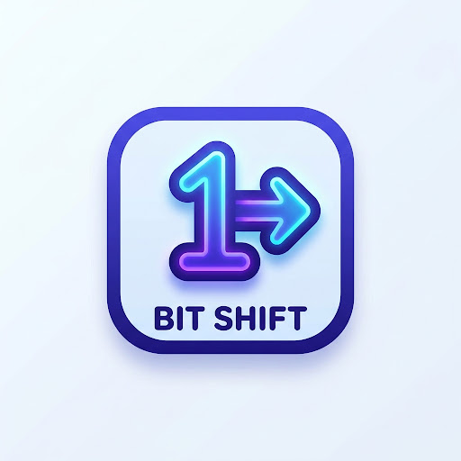

# BitShift

An interactive, quest-based educational game built with **React Native** and **Expo** that teaches the **Shift-and-Add Multiplication Algorithm** used in computer architecture and Arithmetic Logic Units (ALUs).



---

## 🎯 Educational Objectives

BitShift demystifies how processors multiply binary numbers without requiring complex single-cycle multiplication arrays. Players master:

- **Registers & Microarchitecture**:
  - **Carry Register ($C$)**: 1-bit register storing the carry generated during addition (initialized to `0`).
  - **Accumulator ($A$)**: 4-bit ($n$-bit) register storing intermediate partial products (initialized to `0000`).
  - **Multiplier ($Q$)**: 4-bit ($n$-bit) register scanned at its least-significant bit ($Q_0$) before each shift, eventually holding the lower half of the final product.
  - **Multiplicand ($M$)**: 4-bit ($n$-bit) register loaded with the multiplicand, remaining **constant** throughout all cycles.
  - **Combined Register Group ($C-A-Q$)**: $2n + 1$ bits (9 bits for 4-bit operands) shifting **RIGHT** together in every cycle.
- **The Core Decision Rule**:
  - **Step 1: Examine $Q_0$**:
    - **If $Q_0 == 1$**: Add Multiplicand $M$ to Accumulator $A$ ($A \leftarrow A + M$), and store carry-out in $C$.
    - **If $Q_0 == 0$**: Skip addition; keep $C, A, Q$ unchanged during this phase.
  - **Step 2: Combined Right Shift**:
    - Shift combined $C-A-Q$ registers **RIGHT** by 1 bit: Carry $C$ moves into $A$'s MSB ($A[n-1]$), $A$'s LSB ($A[0]$) moves into $Q$'s MSB ($Q[n-1]$), $Q_0$ is discarded, and new $C$ becomes `0`.
  - **Step 3: Repeat for $n$ cycles**:
    - Decrement counter. Repeat until all $n$ bits are processed.
  - **Final Product**:
    - **Product = $A \mid Q$** ($2n$ bits, 8 bits for 4-bit operands).
- **Benchmark Calculation**:
  - $3 \times 5$ ($0011_2 \times 0101_2$) producing the verified 8-bit binary product $0000\,1111_2$ (decimal $15$).

---

## 🚀 Key Features

### 1. Personalized Player Entry
- First-time welcome screen asking for the student's name with input validation.
- Local persistence using `@react-native-async-storage/async-storage` (with localStorage fallback for web).
- Dynamic greeting on the learning dashboard: *"Ready for your next challenge, {Name}?"*
- In-app profile modal allowing players to update their name anytime.

### 2. 5-Level Interactive Quest
- **Exactly 5 Sequential Question Levels** (Level 1 through Level 5).
- **Master Question Bank & Randomization**: Draws 5 distinct randomized questions per quest attempt, with safely shuffled multiple-choice options.
- **Real-Time Answer Validation**: Instant feedback highlighting correct/incorrect choices and revealing architectural insight drawers.
- **Hardware Architecture Hints**: Contextual hints for each question that can be opened and closed without timer resets or penalties.
- **Skip Functionality**: Allows players to skip questions and proceed through the quest.
- **Continuous Hardware Timer**: Tracks elapsed solve time continuously across all 5 questions.
- **QUEST UNLOCKED Completion Screen**:
  - Features the official **QUEST UNLOCKED** milestone banner.
  - Personalized congratulatory message for the player.
  - Complete results breakdown: Correct + Incorrect + Skipped = 5.
  - Total solve time display.
- **Play Again (Replay)**: Starts a fresh attempt with a newly shuffled set of 5 questions, reset timer, and preserved player name.

### 3. Interactive Register Simulator
- Step-by-step hardware cycle execution (`Cycle 1 of 4` through `Cycle 4 of 4`).
- Real-time bit cells for Carry Register ($C$), Accumulator ($A$), Multiplier ($Q$), and constant Multiplicand ($M$).
- **Combined $C-A-Q$ Right-Shift Pipeline**: Visual 9-bit register diagram illustrating carry $C$ shifting into $A[3]$, $A[0]$ shifting into $Q[3]$, and $Q_0$ dropping out.
- **ALU Addition Scratchpad**: Deep midnight navy canvas showing binary arithmetic rows ($A$, $+ M$, $= \text{Sum } A \text{ and Carry } C$) with hexadecimal and decimal readouts.
- **Controls**: *Reset*, *Auto-Play*, and *Next Shift*.
- **Custom Multiplier Sandbox**: Allows testing custom operands (e.g. $7 \times 3$, $15 \times 15$, $0 \times 5$) with live right-shift simulation.

### 4. Trace Matrix & Flowchart
- **3 × 5 Trace Matrix Table**: Complete row-by-row register trace showing Stage, $C$, $A$, $Q$, $Q_0$, and Operation.
- **Hardware Control Flowchart**: Interactive sequential logic flowchart with selectable nodes (*START*, *Initialization*, *Decision Checks*, *ADD / BYPASS branches*, *Combined Right Shift Transition*).
- **Exam Cheat-Sheet Accordions**: Deep dive into $2n$-bit final product storage ($A \mid Q$), $O(n)$ clock cycle proofs, and comparison with Booth's algorithm.

---

## 🛠️ Technology Stack

- **Framework**: [React Native](https://reactnative.dev/) (v0.86.3)
- **Tooling & Runtime**: [Expo](https://expo.dev/) (SDK 57)
- **Web Support**: `react-native-web` & `@expo/metro-runtime`
- **Icons**: `@expo/vector-icons` (MaterialIcons)
- **Local Storage**: `@react-native-async-storage/async-storage`
- **Design System**: Vintage Technical Editorial aesthetic (Parchment `#E6D5B7`, Card Cream `#FAF3E8`, Midnight Obsidian `#1E223D`, Terracotta Flame `#F54F1B`).

---

## 📦 Prerequisites

- **Node.js**: `v18.0.0` or higher (tested on Node v26)
- **npm**: `v9.0.0` or higher

---

## 💻 Installation and Setup

1. **Clone the repository**:
   ```bash
   git clone https://github.com/realrichelle19/BitShift_COA.git
   cd BitShift_COA
   ```

2. **Install dependencies**:
   ```bash
   npm install
   ```

3. **Start the application**:
   - **Web Browser**:
     ```bash
     npm run web
     ```
   - **iOS Simulator** (macOS with Xcode required):
     ```bash
     npm run ios
     ```
   - **Android Emulator / Device** (Android Studio required):
     ```bash
     npm run android
     ```
   - **Expo Dev Server**:
     ```bash
     npx expo start
     ```

---

## 🌐 Web Build and Deployment

BitShift can be deployed as a static web application to any modern hosting platform (GitHub Pages, Vercel, Netlify, Cloudflare Pages):

1. **Export the Web Production Bundle**:
   ```bash
   npm run build
   ```
   This invokes `expo export -p web` and compiles the complete React Native Web bundle into the `dist/` directory, including `dist/index.html` and static assets.

2. **Preview the Production Web Build Locally**:
   ```bash
   npm run serve
   ```
   Or:
   ```bash
   npx serve dist
   ```

3. **Deploy to GitHub Pages**:
   - The repository includes `.github/workflows/deploy.yml` which automatically builds and deploys `dist/` on pushes to `main`.
   - In your GitHub repository settings, go to **Settings > Pages > Build and deployment**, and set **Source** to **GitHub Actions**.

4. **Deploy to Vercel / Netlify**:
   - Configuration files `vercel.json` and `netlify.toml` are included.
   - Build Command: `npm run build`
   - Output / Publish Directory: `dist`

---

## 🔒 Security & Environment Notice

- This application does not require external backend API keys or secrets.
- Never commit private keys, `.env` files with credentials, or personal access tokens to this repository.
- Standard `.gitignore` rules are configured to exclude `node_modules/`, `.expo/`, `dist/`, and local caches.

---

## 📜 License

This project is licensed under the MIT License - see the [LICENSE](LICENSE) file for details.
